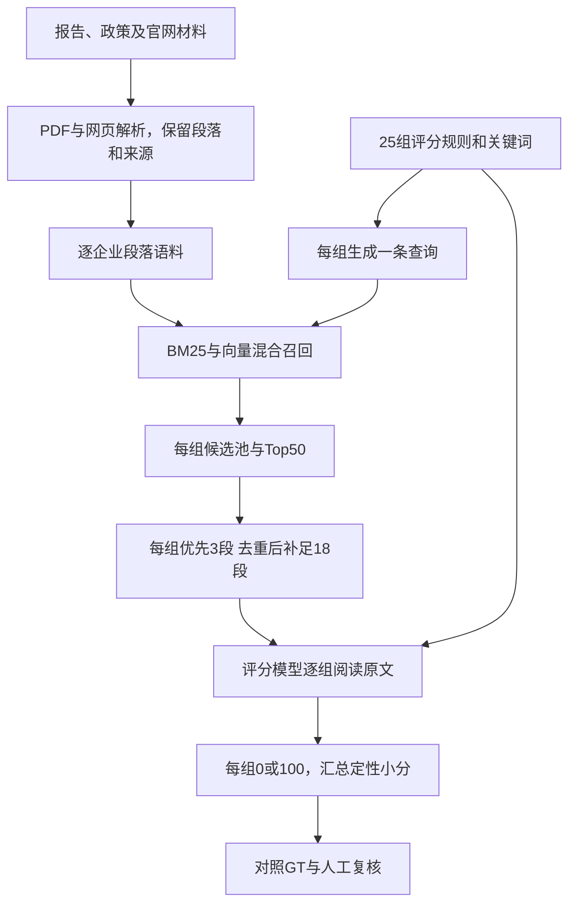

# RAG3.0：S1.1 员工权益分组检索与评分

本文整理 2026-11-23 完成的 RAG3.0 方法及 20 家样本实验。实验围绕五个 S1.1 定性小分，每项五组，共 25 个证据组。检索按组运行，评分按指标运行，评测使用修订版 GT。



## 1. 范围、材料和解析

- 评价年度为2025年，资料包括2025年ESG报告、补充年报、政策、公告及官方网站页面。材料按公司单独建库，覆盖范围因公司而异。
- 此次历史实验并非全部材料均经同一PDF管线解析：主ESG报告使用Docling及自然段重建，补充PDF还使用PyMuPDF版面块，网页使用已保存的网页文本。新实验如果统一使用独立PDF解析器，应单独标注并重新评测。
- 每条检索单元保留ID、原文、章节、页码、来源URL、材料类型、期间与适用范围等字段；这些字段伴随结果送入评分或供人工复核。
- 采集使用官网入口、交易所等来源和员工权益关键词，并人工补充报告。来源选择是否受当时GT材料提示无法仅根据现存脚本确认。

## 2. 证据组和查询

五项指标分别是S1.1.1-C、S1.1.2-C、S1.1.3、S1.1.4、S1.1.5，每项五组，每组权重20%。完整组名、正向与排除条件见 [groups.json](groups.json)，完整评分细则见 [scoring_rules.md](scoring_rules.md)。

每组独立构造一条查询：

```text
2025员工权益；{组名称}；{成立条件}；相关表达：{最多12个组关键词}
```

25条实际查询见 [queries.json](queries.json)。关键词来源于既有关键词表、组映射和补充同义词；查询由程序拼接，不由LLM生成。GT不作为检索查询和模型评分输入。

## 3. 分组混合检索与候选分配

1. 对每组查询分别计算BM25与文档向量相似度，每个通道取前150，合并为候选池。文档向量输入由章节及正文构成，实验中使用1024维向量。
2. 按仓库混合检索核心的综合分排序：语义分0.35、BM25分0.20、语义排名分0.20、BM25排名分0.10、facet分0.15。RAG3.0传入空facet，因此本次facet部分为0。
3. `select_without_reranker` 保护BM25和向量各自前10，再以综合分补足该组Top50，不调用额外reranker。
4. 同一指标内按组轮流选择，每组优先选3个尚未选择的段落。再按各组排序轮流补充，去重后每项最多18段。每个组的查询、优先选中的段落ID及最终候选ID应保存。
5. 评分模型收到该指标的全部候选、五组条件和规则。同一段可以在评分时支持多个组。

本次embedding配置使用 `text-embedding-3-small`、1024维；具体服务地址和凭据通过环境配置提供。缓存按文本、模型和维度标识，文本变化需要重新计算。

## 4. 评分与人工复核

评分使用Qwen `qwen3.8-max`，temperature=0、thinking关闭。完整系统提示和评分提示见 [scoring_prompt.md](scoring_prompt.md)，其中包含内部人力资源审计特别规则和五条判定案例。

每项将公司、年份、规则、五组定义及最多18个候选段落送入模型。模型按组输出0或100、理由，以及引用的段落ID和原文。候选中未找到支持时按0处理；引用匹配用于辅助核对。五组分数求和除以5，得到该定性小分。经核实的严重未纠正事项保留特殊状态，交由人工处理。

原文、模型引用及理由需要逐条核对主体、年份、员工范围和上下文。模型生成的引用可能过短或格式不完整，应回看完整候选段落。

## 5. 实验结果

20家企业、每家5项，按照修订版GT比较：

| 指标 | 结果 |
|---|---:|
| 最终分完全一致 | 63/100（63%） |
| 证据组一致 | 424/500（84.8%） |

前5家使用已保存的RAG3.0评分，其余15家按同一分组检索和评分规则补跑。其中一个输出不完整的项目追加了简短输出约束后补跑。五家公司曾参与规则与提示词调整，整体结果用于开发实验分析。

## 6. 可复现边界

仓库现有 `esg_qualitative_rag/core.py` 提供BM25、混合候选池及无reranker排序。这里发布方法定义、25组规则、实际查询和评分提示，未包含本地材料、修订GT、评分请求、embedding缓存及20家实验结果文件，也未将本地RAG3.0入口改造成此仓库的可执行CLI。要独立重跑，还需要准备对应材料和GT，并实现或迁移组间选段、评分调用和评测入口；不要将GT用于模型输入。

材料清单应固定来源、年度、下载版本及解析方式。环境变量和API密钥通过本地配置提供，不写入版本库。
